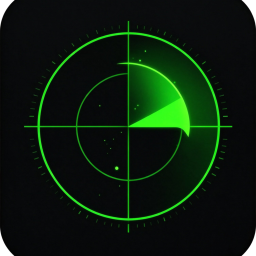

# Flight Radar · 航班雷达

一个纯前端的「老式绿色荧光雷达」风格实时航班显示器：打开就是雷达盘，锁定任意目标看机型、航线、实时高度/速度/航向和飞行轨迹；可以叠在高德街道图或卫星图上；也能做成一个 140 KB 的 Android APK 装在手机上。

网页版和 APP 共用同一份前端代码，区别只在于：网页版靠 `server.js` 提供静态文件和一个小的 HTTPS 代理，APP 里由内嵌的 `AssetServer`（纯 Java，127.0.0.1 随机端口）提供同样的服务，然后用 WebView 打开。



## 功能

- **雷达盘**：距离圈 / 方位线 / 刻度 / 扫描线，纯 Canvas 绘制；7 档配色（绿、琥珀、青、红、冰白…），背景亮度与线条透明度可 0–100 任意调，最低可到纯黑。
- **12 档量程**：5 / 10 / 30 / 70 / 120 / 200 / 400 / 500 / 700 / 1000 / 1500 / 2000 km。大范围会自动切成「渐进外环扫描」，圆盘一轮一轮长满，不会卡住首屏。
- **锁定目标**：点一下飞机 → 绿色四角框 + 实时数据面板（呼号、机型、注册号、高度、地速、升降率、应答机、数据源），并开始累积飞行轨迹；航线（起降机场）来自 adsbdb。
- **三种视图**：纯雷达 / 地图 / 卫星（高德瓦片，经本地服务代理，避开跨域与防盗链）。
- **屏幕效果开关**：横条纹、扫描线、扫掠尾迹（可以把扇形染色整块关掉，只留一根细线）。
- **朝向向上**：手机指南针让雷达盘跟着转（地图/卫星模式不转，否则瓦片会歪）。
- **⌖ 定位**：换城市后点一下，重新走 GPS → IP 定位，清缓存、清航迹、自动切卫星图。
- **数据源面板**：每个源的健康度（请求数/成功/失败/最近一次/限流冷却）、单独开关、自定义源。
- **点星提示**：用满 3 次后弹一次「可以给我点个星星吗」；点「去点星星」跳 GitHub 且以后不再出现，点「我在用」隔一周再问。

## 数据来源

| 源 | 接口 | 认证 | 说明 |
| --- | --- | --- | --- |
| adsb.lol | `https://api.adsb.lol/v2/point/{lat}/{lon}/{nm}` | 无 | 半径上限 250 NM；会间歇 429，命中后冷却 45 s |
| adsb.fi | `https://opendata.adsb.fi/api/v2/lat/{lat}/lon/{lon}/dist/{nm}` | 无 | 同上，字段几乎一致 |
| OpenSky | `https://opensky-network.org/api/states/all?lamin=…` | 无 | 匿名约 400 次/天；适合大范围一次拿一大片 |
| adsbdb | `https://api.adsbdb.com/v0/callsign/{cs}` | 无 | 呼号 → 航司/起降机场 |
| 高德 | `webrd01.is.autonavi.com` / `webst01.is.autonavi.com` | 无 | 街道 / 卫星瓦片 |

三个航班源都**没有 CORS 头**，所以浏览器和 WebView 都不能直连：解析、去重、合并全部在前端 `providers.js` 里做，只把「取文本」这一步交给本地代理（网页版 `/api/fetch?u=`，APK 里 `AssetServer` 的同名路由），代理只放行白名单域名 + 仅 https。

多个源的结果按 icao24/hex 合并，字段互补（哪个源的字段更全就用哪个），所以详情面板里能看到如 `adsb.fi + adsb.lol` 这样的多源标记。

## 运行网页版

```bash
bash start.sh          # 默认 http://127.0.0.1:4173/
PORT=8080 bash start.sh
```

`start.sh` 是幂等的：端口已经在跑就直接打印地址。改了代码要重启，先杀掉旧的 `node server.js`。

## 构建 APK

```bash
ANDROID_JAR=/path/to/android.jar \
D8_JAR=/path/to/build-tools/lib/d8.jar \
APKSIGNER_JAR=/path/to/build-tools/lib/apksigner.jar \
bash android/build.sh
```

- 有 `aapt` 时会用它打包（带真实的 `resources.arsc`，启动图标/圆形遮罩都正常）。
  aapt 需要**带资源表的 framework**：脚本默认优先 `/system/framework/framework-res.apk`，
  因为 SDK 里的 `android.jar` 通常只有 class stub。可用 `FR_FRAMEWORK=` 覆盖。
- 没有 `aapt` 时退回 `android/mkmanifest.js`：用手写的二进制 AXML + `pack.js`（纯 Node 打 zip），
  只需要 JDK + d8 也能出包，代价是没有自定义图标。
- keystore 不存在会自动 `keytool -genkeypair` 生成 `android/keystore/release.jks`，口令写在旁边的 `.pass` 文件里（都在 `.gitignore` 中）。自用请换掉。

工作目录约定：`public/` 是前端资源，`android/` 是打包脚本与 Java 源码（`MainActivity` 负责 WebView、全屏、定位权限、外链跳系统浏览器；`AssetServer` 负责本地 HTTP 与代理）。

## 接一个自己的数据源

运行时的 `window.FRData` 就是数据层，三行就能接一个新接口：

```js
FRData.registerProvider({
  name: 'my-api',
  maxRadiusNm: 250,            // 单次请求最大半径
  gapMs: 900,                  // 同一主机的请求间隔
  ttlMs: 10000,                // 该源结果缓存多久
  buildUrl: ({ lat, lon, radiusNm }) => `https://my.api/point?lat=${lat}&lon=${lon}&r=${radiusNm}`,
  parse: (text) => {
    const j = JSON.parse(text)
    return j.aircraft.map(a => ({ hex: a.icao, flight: a.call, lat: a.lat, lon: a.lon,
                                  altitude: a.alt_ft, velocity: a.gs_kts, heading: a.track }))
  },
})
```

`parse` 只要返回带 `hex / lat / lon` 的对象数组即可，其余字段允许缺省（归一化在 `normalizeAircraft` 里做）。
域名必须同时加进两处白名单：网页版 `server.js` 的 `ALLOWED_HOSTS`，安卓版 `AssetServer.java` 的 `ALLOWED`。

界面上也能加：右上角「◉ 数据源」→ 填名称和地址模板（`{lat}`、`{lon}`、`{radius}` 海里、`{radiusKm}`），
返回 JSON 里含 `ac` / `aircraft` / `data` 数组即可，配置存在 localStorage（`fr.customsrc`）。

## 已知限制

- **中国大陆的 ADS-B 地面站分布极稀疏**。成都市区 120 km 内经常是 0 架，200 km 内个位数，要看到密集航班得把量程拉到 500 km 以上或换到沿海城市。这不是程序的问题，是接收机覆盖的问题。
- **通用航空 / 小飞机基本抓不到**：这些源里出现的几乎都是 A320/B738/A359 一类民航，偶尔有直升机；低空小飞机依赖地面接收站，免费网络源几乎不给。
- 免费源有限流（429），本程序的做法是：按主机串行限速、命中 429 后对该源冷却 45 s、失败回退上一次成功的数据（界面会标注是缓存）。
- 2000 km 档是「渐进扫描」，第一次铺满大约 1–2 分钟；之后走缓存。
- 定位优先 GPS，失败退 IP（IP 定位的误差可能到几十公里）。
- 瓦片来自高德，仅个人自用；商用请自行换源。

## License

MIT，见 [LICENSE](LICENSE)。
